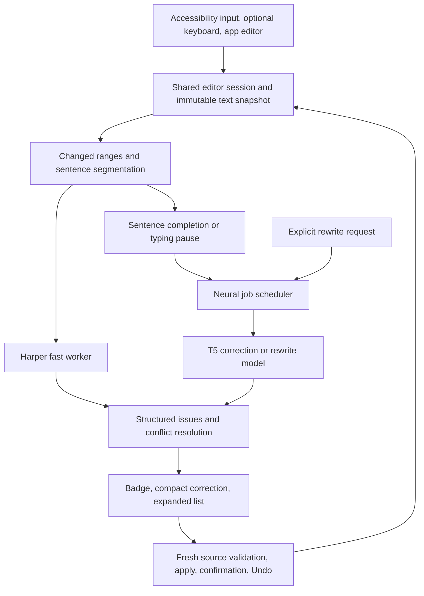

# Offline checking research and proposed architecture

Implementation update (0.2.2): Harper and Unbabel T5 now supply the active checking paths through Rust/JNI and llama.cpp. The migration baseline ONNX tagger and old frequency spelling checker have been removed, together with ONNX Runtime and their assets. The comparisons below retain the original research context.

Implementation follow-up: version 0.2.0 implements the Harper + Unbabel design below using native Rust/JNI and a T5 Q8_0 GGUF adapter in the existing llama.cpp runtime. The descriptions of the former app are the source audit that motivated this work. See [Harper implementation](HARPER_INTEGRATION.md), [T5 integration](CONTEXT_MODEL.md) and [build record](VALIDATION.md). Compilation and static packaging checks do not establish model quality or real-device behavior.

Research date: 2026-10-10. Scope: the supplied article, every listed engine/checkpoint, our current Kotlin implementation, and Android integration. This is a recommendation, not a completed engine migration. No model inference, app tests, emulator, phone interactions, or performance benchmarks were run. Upstream source inspection was sufficient to assess the architectural hypotheses; compilation and correction quality remain open.

## Recommendation

Use **Harper through a native Rust/JNI bridge for continuous English checking**, with **Unbabel GEC T5-Small as the first candidate for deeper contextual checking** after a sentence ends or typing pauses. Keep generative rewriting an explicit user action. Retain our existing small tagger as a selectable baseline during migration; remove redundant engines once their coverage is understood. Do not run three neural models for every keystroke.

This is an engineering shortlist based on integration burden, available artifacts, training documentation, and task fit. It is not evidence that Harper plus Unbabel achieves the best accuracy on the phone. LanguageTool remains a credible alternative or complementary checker if its additional coverage justifies an Android compatibility fork. Our earlier LanguageTool recommendation is revised by this comparison: **Harper is the simpler first integration candidate**, while LanguageTool's coverage remains valuable to investigate.

The largest immediate improvements should come from restructuring scheduling, suggestion data, and UI state. Changing model weights alone does not address those problems.

## Corrections to the supplied article

1. **Our app already uses GECToR-style tagging.** Its quantized `kotoshu/grammar-en` model predicts word-level edits across four passes. Moving to the GECToR architecture is not itself a new solution. A different checkpoint needs its own tokenizer, label vocabulary, decoding contract, and calibration. The current model author reports precision 0.615, recall 0.280, and F0.5 0.496 on CoNLL-2014; these are not Android results. [Current model card](https://huggingface.co/kotoshu/grammar-en/blob/7a64ebe0e1944f9de3c5060cb6cdbd0543826002/README.md).
2. **Current Harper is not entirely without neural weights.** Its rules use POS annotations and a small local neural noun-phrase chunker. This is substantially different from a large generative Transformer, but the table's absolute claim of no neural weights is inaccurate for the inspected release. [Parser source](https://github.com/Automattic/harper/blob/b0ab21f5500da525c76553c56ca1b6b7669c6a78/harper-core/src/document.rs#L175).
3. **A quarter of FP32 checkpoint size is a theoretical weight estimate.** It does not establish an actual downloadable INT8 graph, APK size, or peak RAM. Some tensors stay floating point; encoder/decoder graphs can duplicate shared weights. Quantization can affect accuracy and need not improve speed. The proposed 60–70 MB download and 150–400 MB working-memory ranges are unmeasured. [ONNX quantization guidance](https://onnxruntime.ai/docs/performance/model-optimizations/quantization.html).
4. **Benchmark numbers cannot be moved between checkpoints.** GECToR's historical speed comparison is an experiment against a particular sequence-to-sequence system. Official GECToR, gotutiyan, our DistilRoBERTa model, and Unbabel have distinct artifacts and settings. The article's rankings are hypotheses, not a head-to-head mobile evaluation. [GECToR paper](https://aclanthology.org/2020.bea-1.16/).
5. **The Android discussion omitted our existing integration.** We can retain the user's keyboard through Android 13+ accessibility `InputMethod`, with an accessibility input connection. Requiring our custom keyboard would weaken the requested product flow. A better grammar model cannot supply geometry or editing access that the host app omits. [Accessibility input connection](https://developer.android.com/reference/android/accessibilityservice/InputMethod.AccessibilityInputConnection), [character geometry](https://developer.android.com/reference/android/view/accessibility/AccessibilityNodeInfo#EXTRA_DATA_TEXT_CHARACTER_LOCATION_KEY).

## Engine and model decisions

Checkpoint sizes below are actual upstream file metadata inspected during research, in decimal MB. They are not RAM usage or optimized Android bundle sizes. License entries describe the relevant upstream declaration; code, datasets, and separately distributed weights must be distinguished.

| Candidate | Checkpoint and license | Decision |
| --- | --- | --- |
| [Harper](https://github.com/Automattic/harper/tree/v2.12.0) | Apache-2.0 core; rules, dictionaries, and small embedded parser resources | First continuous checker candidate through JNI. Android build/performance unverified. |
| [LanguageTool](https://github.com/languagetool-org/languagetool) | LGPL-2.1-or-later community engine; no single neural checkpoint | Strong maintained rule engine; greater Android adaptation work. Keep as coverage candidate. |
| [Unbabel GEC T5-Small](https://huggingface.co/Unbabel/gec-t5_small) | 242.08 MB FP32 PyTorch; Apache-2.0 card | First deeper contextual correction candidate. |
| [xhimanshuz FLAN-T5-small grammar](https://huggingface.co/xhimanshuz/flan-t5-small-grammar-correction) | 307.87 MB FP32 safetensors; Apache-2.0 card | Demonstration training; insufficient evidence to select as default. |
| [gotutiyan GECToR RoBERTa-base-5k](https://huggingface.co/gotutiyan/gector-roberta-base-5k) | 511.64 MB safetensors; explicit non-commercial limitation | Useful research candidate; no card benchmark establishes an upgrade. |
| [Official Grammarly GECToR](https://github.com/grammarly/gector) | Apache-2.0 implementation; separate `.th` weights | Reference architecture and later checkpoint candidate; clarify weight terms separately. |
| [dhruv-pype CoEdIT FLAN-T5-base](https://huggingface.co/dhruv-pype/coedit-flan-t5-base) | 990.35 MB FP32 safetensors; Apache-2.0 metadata | Exclude from default shortlist; documentation and evaluation are weak. |
| [Vennify T5-base grammar](https://huggingface.co/vennify/t5-base-grammar-correction) | 891.73 MB FP32 PyTorch; CC-BY-NC-SA-4.0 | Larger fluency candidate with insufficient comparative evidence. |
| [Grammarly CoEdIT-large](https://huggingface.co/grammarly/coedit-large) | 3,132.44 MB FP32 safetensors; CC-BY-NC-4.0 | Optional future revision research; too costly to require for continuous phone checking. |
| [Current kotoshu grammar model](https://huggingface.co/kotoshu/grammar-en) | 85.83 MB actual INT8 ONNX; CC-BY-NC-SA-4.0 research-only card | Useful existing baseline, with limited reported recall. |
| [Current Qwen2.5-0.5B rewrite model](https://huggingface.co/Qwen/Qwen2.5-0.5B-Instruct-GGUF) | Our pinned Q4_K_M file is 491.40 MB; Apache-2.0 card | Keep for explicit rewriting while reviewing size and quality; not an every-keystroke checker. |

**Unbabel** uses six-layer T5-small and a `gec: ` prefix. The card claims F0.5 60.70; its referenced paper's Table 4 currently reports 60.54 for T5-small on CoNLL-2014 and 65.01 on BEA-2019. This discrepancy is a reason to avoid promising either number for the checkpoint. The example uses five-beam decoding; faster greedy mobile generation would change the configuration. It needs tokenization, generation, and edit extraction, and does not produce reliable linguistic explanations. [Model card](https://huggingface.co/Unbabel/gec-t5_small), [paper](https://arxiv.org/html/2106.03830).

**Official GECToR** includes edit and detection heads, a START token, subword alignment, transforms, iterative inference, and confidence/error thresholds. Its README reports RoBERTa scores of 64.0 on CoNLL-2014 and 71.8 on BEA-2019, explaining that a newer Transformers version changes results from the paper. None of these numbers apply to another checkpoint automatically. **Gotutiyan** has a custom configuration with 5,002 edit labels, three detection labels, and a configured maximum length of 80. Its weights cannot replace our ONNX file without an adapter. [Official source](https://github.com/grammarly/gector/tree/3d41d2841512d2690cffce1b5ac6795fe9a0a5dd), [gotutiyan card/config](https://huggingface.co/gotutiyan/gector-roberta-base-5k).

**The community FLAN models** do not provide compelling deployment evidence. xhimanshuz documents 2,000 training examples over three epochs and calls it a demonstration; its prompt is `Fix the grammar: `. dhruv-pype's card contains inconsistent example predictions and usage outputs, conflicting sample-count statements, and BLEU/ROUGE/exact-match metrics rather than a comparable GEC edit benchmark. This does not prove either model always fails; it means the published evidence is insufficient. [Small FLAN card](https://huggingface.co/xhimanshuz/flan-t5-small-grammar-correction), [base FLAN card](https://huggingface.co/dhruv-pype/coedit-flan-t5-base).

**Vennify** uses `grammar: `, is trained on JFLEG, and presents an example without a comparative edit benchmark. **Official CoEdIT-large** supports broader instruction-driven revisions, making it more relevant to deliberate rewriting than live spelling checks. Its dataset advertises Apache-2.0 while the official weights advertise CC-BY-NC-4.0; the dataset terms must not be confused with weight terms. Non-commercial weights are not automatically unusable for this private project, but they should remain clearly identified. [Vennify card](https://huggingface.co/vennify/t5-base-grammar-correction), [CoEdIT model](https://huggingface.co/grammarly/coedit-large), [CoEdIT dataset](https://huggingface.co/datasets/grammarly/coedit).

## Harper integration details

Inspected stable release: v2.12.0, commit `b0ab21f5500da525c76553c56ca1b6b7669c6a78`. Use `harper-core` directly; Android does not need the language server or JavaScript/WASM wrapper. Build a small Rust `cdylib` for `aarch64-linux-android`, expose JNI, and package an `arm64-v8a` library. Rust officially supports Android native targets. This establishes a plausible integration route, not a verified Harper Android SDK. [Harper architecture](https://writewithharper.com/docs/contributors/architecture), [Rust platform support](https://doc.rust-lang.org/rustc/platform-support/android.html).

Construct `FstDictionary::curated()`, `Document::new_plain_english(...)`, and `LintGroup::new_curated(...)`; `LintGroup::default()` is empty. Reuse the checker on a worker. Linters provide range, category, message, priority, and zero or more suggestions. `ReplaceWith`, `Remove`, and `InsertAfter` have distinct meanings; insertion must preserve the marked text. No-fix issues are reviewable but cannot be accepted automatically. [Lint group](https://github.com/Automattic/harper/blob/b0ab21f5500da525c76553c56ca1b6b7669c6a78/harper-core/src/linting/lint_group/mod.rs#L576), [suggestions](https://github.com/Automattic/harper/blob/b0ab21f5500da525c76553c56ca1b6b7669c6a78/harper-core/src/linting/suggestion.rs#L13).

Native spans index Unicode scalar values, with an exclusive end. Convert every boundary to UTF-16 at JNI before combining with Android editor offsets. An emoji before a mistake otherwise shifts the underline and replacement. The existing WASM wrapper demonstrates the required conversion. Use merged personal/curated dictionaries, and expose American, British, Indian, Australian, and Canadian dialects rather than a small spelling replacement map. [Span conversion](https://github.com/Automattic/harper/blob/b0ab21f5500da525c76553c56ca1b6b7669c6a78/harper-wasm/src/lib.rs#L703), [dialects](https://github.com/Automattic/harper/blob/b0ab21f5500da525c76553c56ca1b6b7669c6a78/harper-core/src/dict_word_metadata.rs#L1129).

The parser includes Brill POS tagging and a Burn/ndarray noun-phrase model. Embedded chunker vocabulary and weights are 627,993 and 806,312 bytes respectively; these do not measure compiled footprint or RAM. Its thread-local sentence cache has a capacity of 10,000. Keep one reusable worker and review cache bounds for a phone. Omitting the optional thesaurus does not disable the parser model. Retain synonyms if the product exposes them. The wrapper must contain JNI failures, preserve notices, use an appropriate Rust toolchain, and satisfy Android 16 KiB native alignment. [Embedded resources](https://github.com/Automattic/harper/blob/b0ab21f5500da525c76553c56ca1b6b7669c6a78/harper-brill/src/lib.rs#L39), [core features](https://github.com/Automattic/harper/blob/b0ab21f5500da525c76553c56ca1b6b7669c6a78/harper-core/Cargo.toml#L56), [Android page sizes](https://developer.android.com/guide/practices/page-sizes).

Harper remains a maintained rule engine supported by linguistic analysis. It avoids writing app-specific phrase exceptions, but it cannot guarantee every contextual or semantic error will be found. LanguageTool has additional POS, disambiguation, chunking, XML/Java rules and spelling resources. Its in-process Java API needs no HTTP server. Our [LanguageTool feasibility report](LANGUAGETOOL_FEASIBILITY.md) details parser, resources, Java API and dependency/telemetry adaptations. Source inspection does not show which engine detects more of the user's actual mistakes. [LanguageTool architecture](https://dev.languagetool.org/development-overview), [Java API](https://dev.languagetool.org/java-api).

## Runtime choice

Keep **ONNX Runtime CPU** as the initial neural reference path because the app already integrates it. A T5 adapter needs an encoder pass, decoder initiation, token loop, caches, EOS/length limits, and exact SentencePiece behavior. Exporting graphs does not provide Kotlin with Transformers' `generate()`. Review decoder merging and shared-weight duplication before publishing size estimates. [Mobile workflow](https://onnxruntime.ai/docs/tutorials/mobile/), [Optimum export](https://huggingface.co/docs/optimum-onnx/onnx/usage_guides/export_a_model).

Treat XNNPACK or vendor acceleration as later optimizations dependent on supported operators. **NNAPI is deprecated starting in Android 15**, so it should not be the architecture's performance assumption. **ExecuTorch** provides Android Kotlin/Java bindings and is credible if a particular exported graph/backend offers a measured benefit; adding another runtime now increases integration work without established improvement. [Android NNAPI status](https://developer.android.com/ndk/guides/neuralnetworks), [ExecuTorch Android](https://docs.pytorch.org/executorch/stable/using-executorch-android.html).

An additional route omitted from the article is our existing **llama.cpp** library. The pinned source contains T5 conversion, SentencePiece configuration and encoder-decoder execution. A GGUF T5 could potentially reuse that runtime and reduce graph duplication. Our current JNI wrapper only performs decoder calls with Qwen prompts, so it requires a separate T5 execution adapter and conversion/tokenizer parity checks. T5 support in the library does not establish that Unbabel already works in this app. [T5 converter](https://github.com/ggml-org/llama.cpp/blob/master/conversion/t5.py). Compare this route with ONNX before maintaining two T5 implementations; begin with conservative precision rather than assuming aggressive INT4 is quality-neutral.

## Proposed application architecture

Recommended boundaries: `EditorSession` and platform adapters; `AnalysisCoordinator`; `FastChecker`; `ContextChecker`; `RewriteEngine`; `IssueStore`; `EditApplier`; and `OverlayController`. These are responsibilities, not a demand for an extensive framework. Preserve Kotlin UI and existing Android accessibility mechanisms.

The current implementation has the following source-visible limitations:

- `Engine.kt` puts grammar, spelling, rewrite, and tone on one executor. Grammar runs before spelling, so basic findings await neural work. A long rewrite can occupy that executor. Provide an independent bounded fast worker and one coordinated heavy-model queue; do not oversubscribe the phone with concurrent heavy inference.
- `AnalysisSession` uses a uniform 550 ms delay. `GrammarEngine` rechecks the supplied sentences and uses a punctuation regex that can split abbreviations and decimals. Segment with a robust tokenizer, cache unchanged sentences, and check only the changed region plus necessary context. Ignore stale results and stop obsolete heavy work where the runtime permits.
- `Edit` stores only start/end/replacement. The UI derives approximate titles from the string diff. Replace it with an issue carrying stable identity, field/text revision, original span/text, source/rule identity, category, explanation when available, alternative atomic edit sets, and calibration status. Keep warnings without replacements. A model score is not an automatically calibrated probability.
- Current dismissal identity is just original text plus replacement. Repeated occurrences can share an identity; panel updates clear dismissals on changed text. Preserve dismissals for unchanged anchored occurrences within the editor session, without persisting user text.
- Grammar output joins words with normalized spaces before diffing. Preserve original whitespace and punctuation through source mapping and localized edits. `TextLogic.diff` allocates a quadratic LCS table; bound neural alignment to sentences and use a suitable diff for larger explicit rewrites.
- British preference is implemented with a short mapping. Use dialect dictionaries/rule settings consistently, and apply personal dictionary exemptions to spelling rather than blanket-suppressing grammatical findings involving that word.
- Panels and surfaces own separate analysis sessions. Make them subscribe to one issue store for their captured field so badge, underlines, compact card, and full list agree and opening a panel does not restart the same work.

Deduplicate identical findings, preserve competing replacements as choices, and resolve overlaps before bulk application. Multiple independent engines agreeing is useful evidence, but not sufficient proof of correctness. Generate edits against original snapshot coordinates, validate immediately before submission, and confirm the host update before treating it as complete.

## UI and UX changes

1. Keep one small counted badge, visible only during an eligible typing session. Preserve a 48 dp hit target around the current 30 dp visual badge. Keep the user's existing keyboard and the requested **badge -> compact correction -> expanded list** flow.
2. Use one explicit overlay state machine. Opening the panel or transient IME/window events must not dismiss it; leaving the actual editor closes it. Geometry updates and analysis updates should be independent.
3. Publish fast findings immediately, then add deeper findings without changing the selected card or scroll position. Keep verified findings in unaffected text while checking changed text; invalidate affected findings before allowing application.
4. Show a distinct pending/failed/unavailable state. A finished rule pass with no results while contextual checking is pending should say **No suggestions found so far**, not **You're all set**. Completed checking should say **No suggestions found**, which does not claim the text is grammatically perfect.
5. Compact cards show the exact old/new text and a short genuine rule message. Expanded cards show context, explanation where available, alternatives, Accept, Dismiss, and Add to dictionary for spelling. Use a neutral title for neural suggestions that lack a trustworthy explanation.
6. Separate optional style advice from likely spelling/grammar corrections; avoid filling chat drafts with formal prose preferences. The badge counts deduplicated actionable findings, with optional advice separately visible.
7. Applying a correction keeps the panel open, confirms the change, offers Undo, and moves to the next stable issue. Bulk acceptance uses only compatible actionable edits. Rewrites require a preview and explicit acceptance.
8. Draw external underlines only with supported, current host geometry. If geometry is unavailable, retain the useful compact/full correction experience and marked preview. Do not fake coordinates or modify text to inject drawing spans.
9. Keep login, telemetry, cloud checks and runtime fetching absent. Bundle checker/model resources, or offer a separate fully bundled distribution for optional large rewriting features. A local model import could be a later explicit user action; it is not required for normal checks.

## Implementation order and unresolved evidence

First introduce shared issues, field state, scheduling and stable rendering; this helps every engine. Then integrate Harper JNI and its dictionaries, replacing the frequency-only spelling path and narrow dialect map. Next add a Unbabel adapter behind the context-checker interface and sentence-scoped edit alignment. Keep the current tagger as a baseline during that transition. Improve rewrite memory management and unload idle heavy sessions: our JNI code currently retains the loaded Qwen model indefinitely after first use. Add LanguageTool only if the needed coverage warrants its port.

Compilation establishes packaging compatibility, not correction quality. Before promoting a neural candidate, compare original and quantized outputs under identical decoding, use held-out GEC edit evaluation, and inspect changes to already-correct text, names, numbers, URLs, emojis and chat fragments. Published scores from separate setups cannot choose the winner. Actual phone latency, memory, heating, focus stability and external-editor coverage require the owner's manual evaluation. No universal text-field or cloud-Grammarly-equivalence claim is supported.

## Reproducibility ledger

- Harper: sparse clone `/home/aniket/projects/harper`, v2.12.0 / `b0ab21f5500da525c76553c56ca1b6b7669c6a78`. Selected source downloads also retained in `/tmp/harper-v2.12.0-b0ab21f550/`.
- GECToR: clone `/home/aniket/projects/gector`, `3d41d2841512d2690cffce1b5ac6795fe9a0a5dd`.
- LanguageTool: sparse clone `/home/aniket/projects/languagetool`, `8a240373a230477fa2cacfbfec626a681df34b9d`; stable 6.8 assessment uses `e807fcde6a6506191e1470744d2345da28c26be6`.
- Unbabel checkpoint: `c958d53bfbce19c87342b69fc6bcaba7303d076f`.
- xhimanshuz checkpoint: `cd6bb6cdf1b679d2b56535c3ea18a6fcf4cf6e5c`.
- gotutiyan checkpoint: `adaac6fb919431fb5a038b1e449055ae638613a4`.
- dhruv-pype checkpoint: `5f65fd04f1a7ae8a46b1025f7f56fc37a2cae7f5`.
- Vennify checkpoint: `9e4a09d21dca1072a69302df9261289d03c3ed78`.
- CoEdIT-large checkpoint: `5637bcdf9d8d4419f97c8cfea36f7d35c79232b6`.
- Existing bundled model/runtime revisions and exact file hashes remain in `dependencies.lock.json`.
